# ha-ecowatt-card

[](https://www.home-assistant.io/integrations/marketplace/)
[](https://github.com/juju35/ha-ecowatt-card/actions/workflows/hacs.yml)
[](https://github.com/juju35/ha-ecowatt-card/actions/workflows/validate.yml)
[](https://github.com/juju35/ha-ecowatt-card/actions/workflows/lint.yml)
[](https://github.com/juju35/ha-ecowatt-card/releases/latest)
[](https://github.com/juju35/ha-ecowatt-card/blob/main/LICENSE)
[](https://buymeacoffee.com/julienstep9)

<p align="center"></p>

<p align="center">
  <a href="https://www.monecowatt.fr"></a>&nbsp;&nbsp;
  <a href="https://www.myelectricaldata.fr"></a>
</p>

Lovelace cards for Home Assistant for **EcoWatt**, the signal of the French electricity grid published by [RTE](https://www.monecowatt.fr): the **level now**, **today and tomorrow hour by hour** (normal, low-carbon, tight grid, power cuts), the **next days** and the **next tight period**, from the [My EcoWatt by RTE](https://github.com/kamaradclimber/rte-ecowatt), [ecowatt](https://github.com/adetante/ha-ecowatt) or [MyElectricalData](https://github.com/MyElectricalData/myelectricaldata_import) integrations.

The sensors are **discovered automatically** from the Home Assistant entity registry: an empty configuration already shows the signal, whatever your Home Assistant language or entity ids. Any sensor giving a level can also be set in the configuration.

[](https://my.home-assistant.io/redirect/marketplace_repository/?owner=juju35&repository=ha-ecowatt-card&category=plugin)

| EcoWatt Card | EcoWatt Mini Card |
|---|---|
| 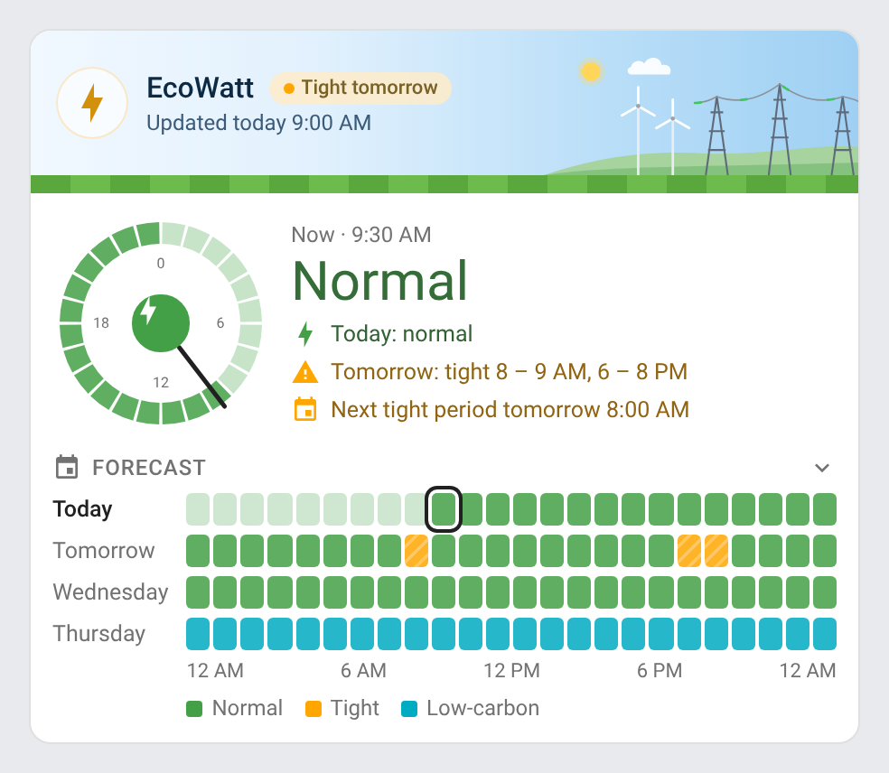 | 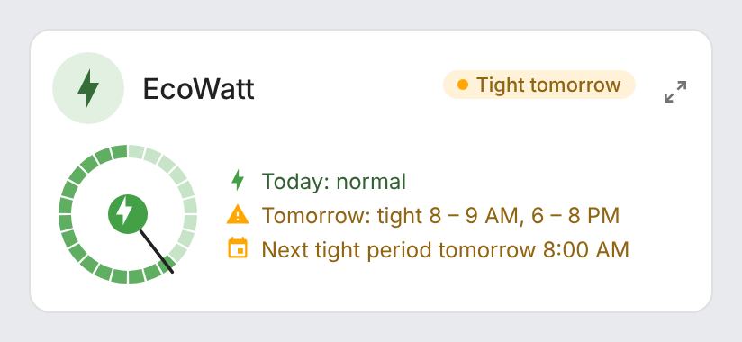<br>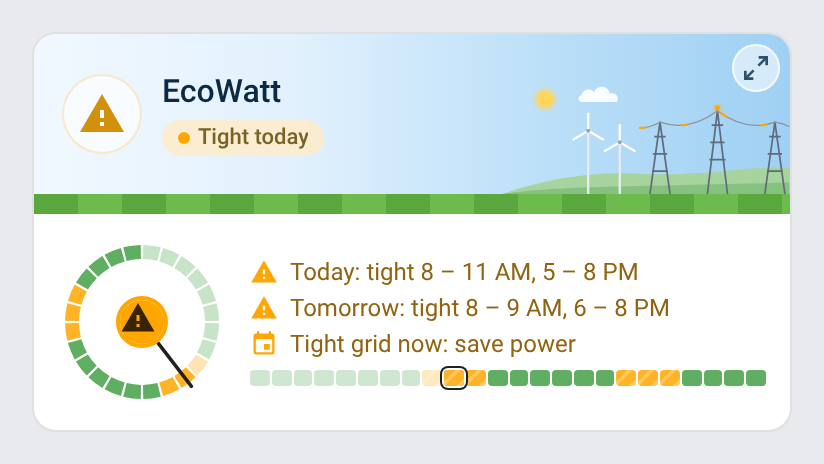 |

## Features

- Two cards: a full **EcoWatt Card** (`custom:ecowatt-card`) and a compact **EcoWatt Mini Card** (`custom:ecowatt-mini-card`)
- The four EcoWatt levels, each with its colour, icon and word: **low-carbon** electricity (teal leaf), **normal** (green), **tight grid** (orange, hatched: cuts possible, save power) and **power cuts** (red, hatched the other way); the hatching tells the levels apart without the colours
- **A 24-hour dial** of today: each hour round the clock in its level's colour, past hours faded, the hand on the current hour and the level now in the middle; a wave goes out of it while the grid is tight, its icon blinks during power cuts (see [Animations](#animations))
- **A 4-day forecast grid**: one row a day, 24 hours a row, the current hour outlined, past hours faded, with a legend of the levels shown; hover or focus an hour to read its hour and level
- The **tight hours** in words ("Tomorrow: tight 8 – 9 AM, 6 – 8 PM"), the **next tight period** ("Next tight period tomorrow 8:00 AM", "Tight grid now: save power")
- **An animated illustrated header** (90 px, full and mini card): the title on the sky at the left, the grid at the right (wind turbines, pylons, power line) over a lawn strip; the pulse running along the line takes the level's colour (teal low-carbon, green normal, orange tight, red cuts), the turbines slow down as the grid tightens and stop during cuts, a beacon blinks on the middle pylon when the grid is tight or cut. Night picture with the dark theme (a light theme keeps the day picture after sunset), or forced with `illustration_theme`; `illustration: false` brings back the classic header
- Header icon in a round badge, in the colour of the level now (grey when unknown), and a status chip under the title: **No alert**, **Tight tomorrow**, **Cuts today**…
- Collapsible forecast section, folded back to their defaults by a click elsewhere on the page
- Detail button on the mini card (top right): it switches the mini card to the full card's content and back; a click anywhere outside the card brings the compact view back
- Click any hour, day or line to open its Home Assistant history (more-info dialog)
- Visual editor in the dashboard UI for both cards (no YAML needed)
- Light and dark mode, English, French, German, Spanish, Serbian (Cyrillic and Latin), Italian, Dutch, European Portuguese, Polish, Romanian, Danish, Swedish, Bulgarian, Russian, Ukrainian, Hungarian, Slovak, Czech, Slovenian, Latvian and Greek
- Single file, no external dependency

## Supported integrations

| Integration | What the cards use |
|---|---|
|  [My EcoWatt by RTE](https://github.com/kamaradclimber/rte-ecowatt) (custom, `rte_ecowatt`) | Its day sensors (today, and the days you added, up to D+3) with their level code; its sensor of the current hour; its calendar of tight hours (*Ecowatt downgraded level*), read for the hours of each day — and for the days without a sensor, so the default setup (today's sensor only) still shows 4 days |
|  [ecowatt](https://github.com/adetante/ha-ecowatt) (custom, `ecowatt`) | Its four day sensors (`sensor.ecowatt_day_0` to `_3`, or by their name *Aujourd'hui*, *Demain*, *J+2*, *J+3* when renamed) and their hourly attributes `h0` to `h23` (Vert / Orange / Rouge) |
|  [MyElectricalData](https://github.com/MyElectricalData/myelectricaldata_import) (add-on, MQTT) | Its EcoWatt sensors `…ecowatt_j0` to `_j2` (level 1 to 3) and their `forecast` attribute, hour by hour |
| Any sensor | Listed in `days`: a level as a number (0 to 3) or a word (green / orange / red, vert / orange / rouge, normal, tight…), with its hours in attributes (`h0`…`h23`, a `forecast` map, or the attribute named by `attribute`) |

The sensors of these integrations are found on their own. Details in [How it works](#how-it-works).

## Prerequisites

Home Assistant 2024.8 or later, with one of the integrations above (or a sensor giving the EcoWatt level).

## Installation

### Via the Marketplace (recommended)

Click the button below to add the repository directly:

[](https://my.home-assistant.io/redirect/marketplace_repository/?owner=juju35&repository=ha-ecowatt-card&category=plugin)

Then click **Install**, and reload your browser when the Marketplace asks you to.

Or manually:

1. Open **Settings → Marketplace → Add from link** (top right; this needs a GitHub account connected)
2. Add `https://github.com/juju35/ha-ecowatt-card` — Type: **Dashboard**
3. Open **EcoWatt Card** and click **Install**
4. Clear your browser cache and refresh

The Marketplace adds the resource `/local/community/ha-ecowatt-card/ecowatt-card.js` for you.

### Manual

1. Download `ecowatt-card.js` and the `ecowatt-card.i18n.*.js` translation files from the [latest release](https://github.com/juju35/ha-ecowatt-card/releases/latest)
2. Copy them all to `/config/www/` (without the translation files, the cards show in English)
3. Go to **Settings → Dashboards → ⋮ → Resources** → Add resource:
   - URL: `/local/ecowatt-card.js`
   - Type: **JavaScript Module**
4. Clear your browser cache and refresh

## Configuration

### Card types

| Card | Type |
|---|---|
| EcoWatt Card | `custom:ecowatt-card` |
| EcoWatt Mini Card | `custom:ecowatt-mini-card` |

### Visual editor

Edit a dashboard, click **Add card** and search for **EcoWatt Card** or **EcoWatt Mini Card**. Everything is discovered when the lists are left empty; pick day sensors, the current hour sensor or the calendar to use only those, choose the sections and the language. The preview updates live, and options left at their default are kept out of the generated YAML.

### Minimal

```yaml
type: custom:ecowatt-card
```

```yaml
type: custom:ecowatt-mini-card
```

### Full options

```yaml
type: custom:ecowatt-card
title: Grid signal
days:
  - sensor.ecowatt_level_today
  - sensor.ecowatt_level_tomorrow
  - entity: sensor.my_ecowatt_d2
    attribute: hours
now: sensor.ecowatt_level_now
calendar: calendar.ecowatt_downgraded_level
show_title: true
show_subtitle: true
show_hours: true
show_days: true
illustration: true
illustration_theme: auto
collapsed: []
language: en
```

```yaml
type: custom:ecowatt-mini-card
zoom: true
language: en
```

### Options reference

| Option | Card | Default | Description |
|---|---|---|---|
| `title` | both | EcoWatt | Card title |
| `show_title` | both | `true` | Show the title in the header |
| `show_subtitle` | both | `true` | Show the subtitle (when RTE published the signal); the mini card shows it in its detail view |
| `days` | both | Automatic | Day sensors, today first: entity ids, or objects with `entity` and `attribute` (the attribute holding the day's hours — objects are YAML only); absent, the sensors of the [supported integrations](#supported-integrations) |
| `now` | both | Automatic | Sensor of the level of the current hour (My EcoWatt by RTE: *Ecowatt level now*) |
| `calendar` | both | Automatic | Calendar whose events are the tight hours (My EcoWatt by RTE: *Ecowatt downgraded level*) |
| `show_hours` | both | `true` | Today's and tomorrow's rows in the forecast; with `false`, the calendar is not read |
| `show_days` | both | `true` | The next days' rows in the forecast |
| `illustration` | both | `true` | Animated illustrated header (the grid in the level's colour); `false`: the classic header |
| `illustration_theme` | both | `auto` | Day or night picture: `auto` (follows the Home Assistant theme: night with a dark theme, day with a light theme), `day` or `night` |
| `collapsed` | both | `[]` | Sections folded by default, only `forecast`. Click a section title (or Tab to it and press Enter or Space) to fold or unfold it |
| `zoom` | mini | `true` | Detail button at the top right of the mini card: it shows the full card's content (with the same options, so `show_days`, `collapsed`… can be set on the mini card too, in its visual editor as well) and switches back to the compact view; a click outside the card also brings the compact view back. `false` removes the button |
| `language` | both | Auto | Force language: `fr`, `en`, `de`, `es`, `sr`, `sr-Latn`, `it`, `nl`, `pt`, `pl`, `ro`, `da`, `sv`, `bg`, `ru`, `uk`, `hu`, `sk`, `cs`, `sl`, `lv` or `el` (auto-detects from HA settings) |

`days` (a list of objects) is edited in YAML only; the visual editor offers it as a list of entities.

## Screenshots

### Animations

The middle of the dial animates when the grid is under stress; it is still otherwise. Each state plays its own animation, and every one of them honours `prefers-reduced-motion`.

When the grid is tight now, a wave goes out of the middle of the dial and the current hour pulses:

| Light | Dark |
|---|---|
| 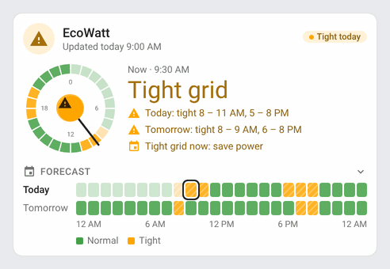 | 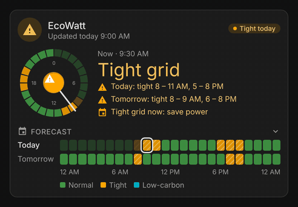 |

During power cuts, the icon in the middle of the dial blinks as well:

| Light | Dark |
|---|---|
| 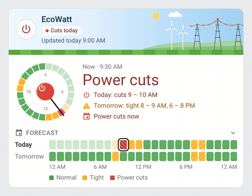 | 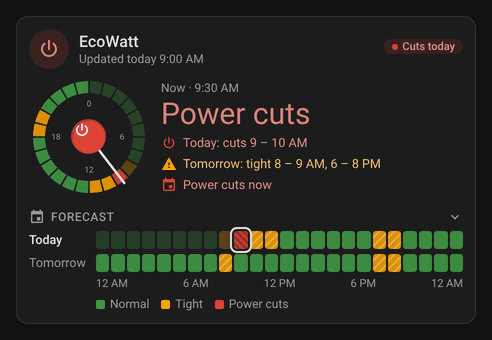 |

### Full card

Today is normal; tomorrow is tight in the morning and the evening; low-carbon electricity on Thursday:

| Light | Dark |
|---|---|
|  | 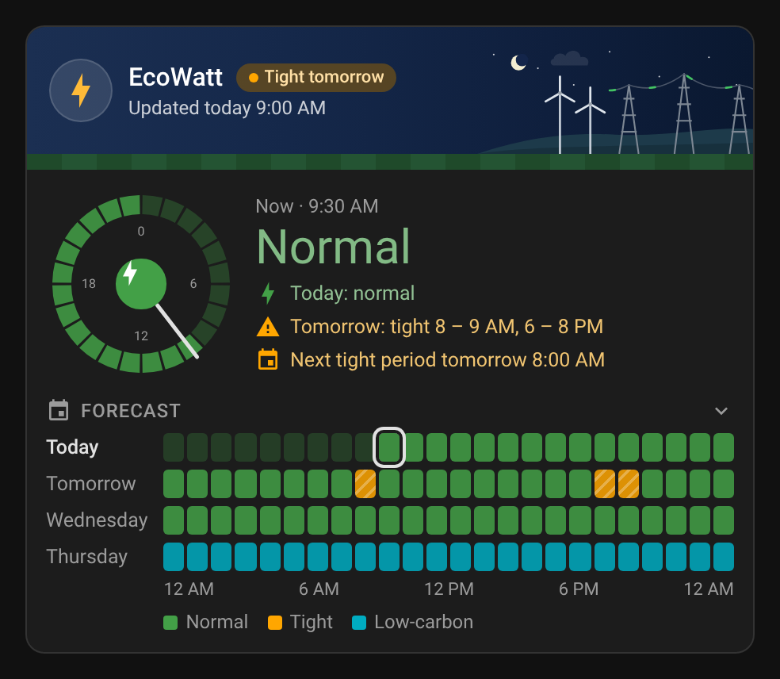 |

Power cuts now (9 – 10 AM), tight around them:

| Light | Dark |
|---|---|
| 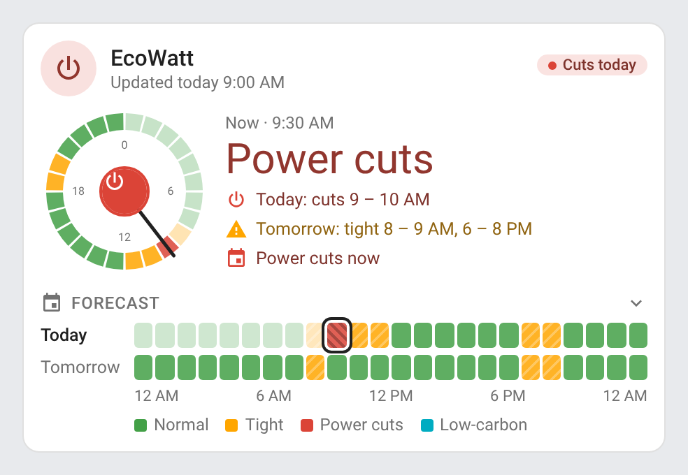 | 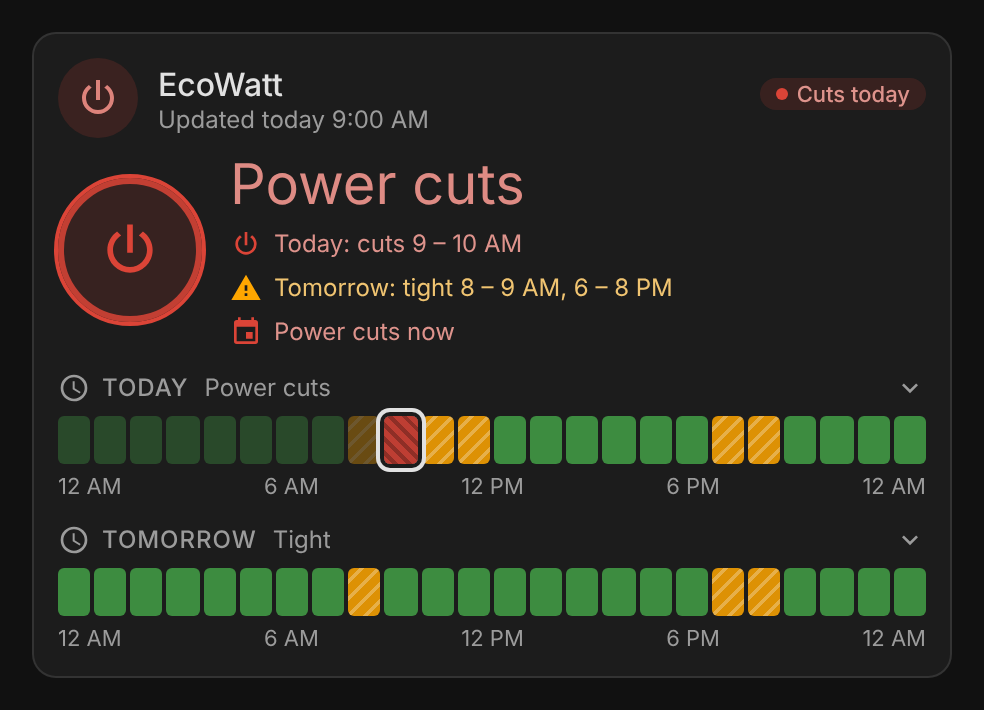 |

### Mini card

A small dial of today, the lines (today, tomorrow, the next tight period) and the strip of the day to watch: today, or tomorrow when only tomorrow is tight.

| Light | Dark |
|---|---|
|  | 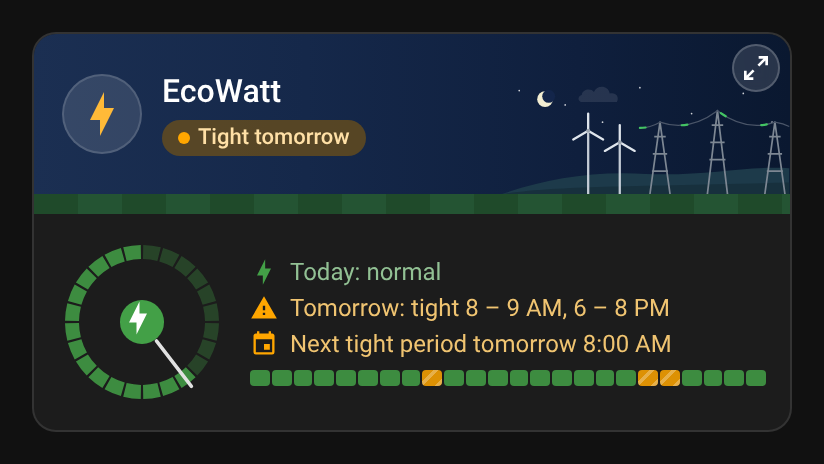 |
|  | 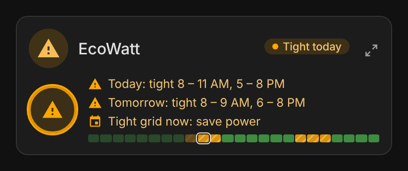 |

The detail button (top right) shows the full card's content:

| Light | Dark |
|---|---|
| 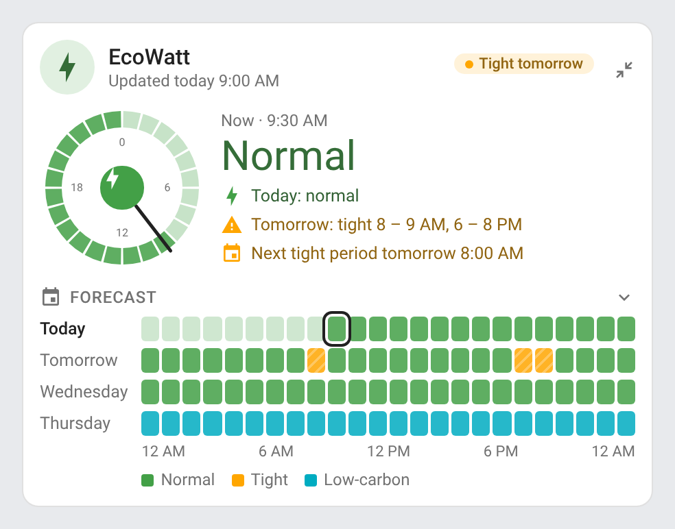 | 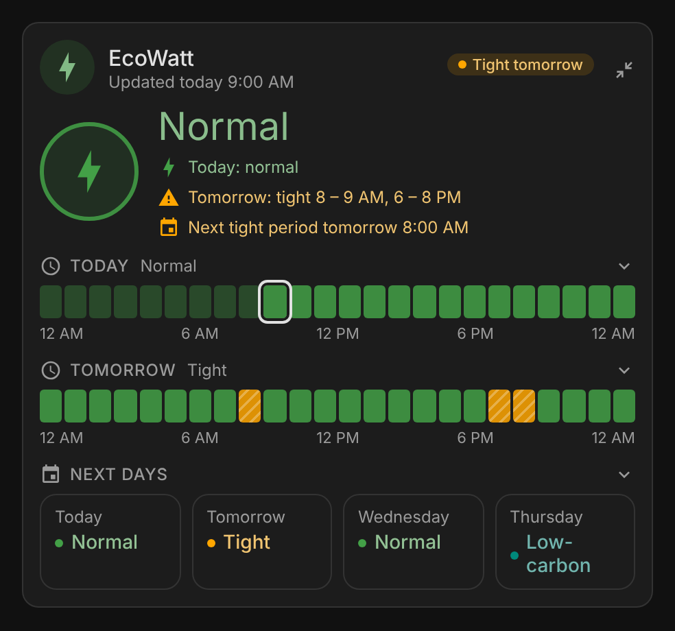 |

### Narrow cards

The full card at 6 columns of a phone's Sections view and the mini card at its minimum width:

| Light | Dark |
|---|---|
| 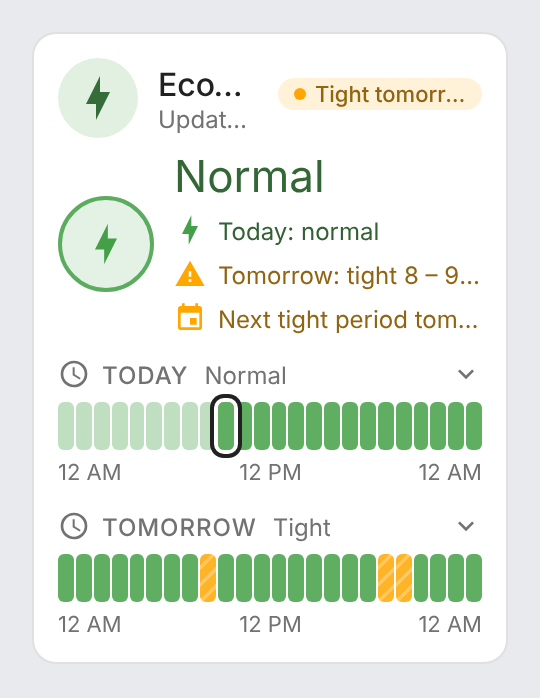 | 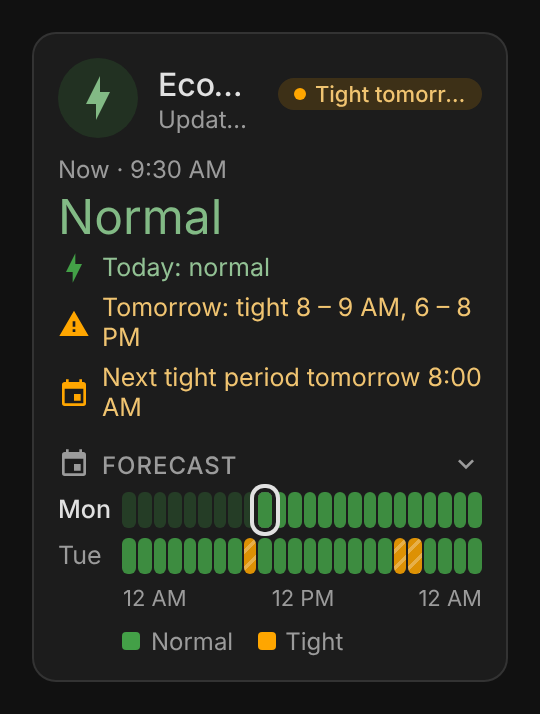 |
| 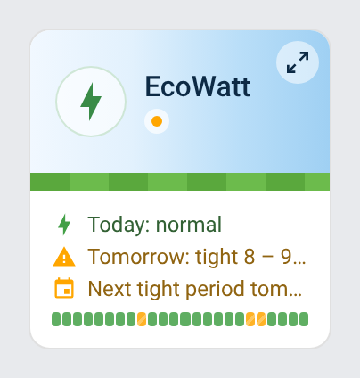 | 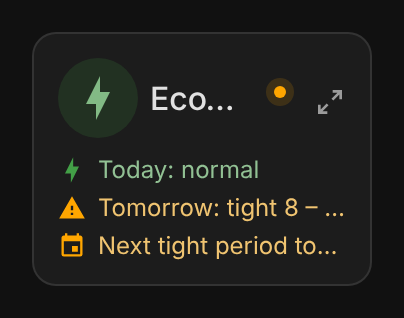 |

## How it works

The cards read the Home Assistant entity registry instead of relying on entity ids, so entity ids can be in any language or renamed.

- **My EcoWatt by RTE**: a sensor whose period (`period_start` to `period_end`) is a day gives that day's level (`level_code`, else its text); one whose period is an hour gives that hour. The integration lists the tight hours in its calendar: the cards fetch its events for the four days shown (again when the calendar changes, and every 30 minutes), each event setting its hours to its level (*Le niveau ecowatt prévu est 2*). The other hours of a normal day are normal; a tight day whose hours are not published yet says so.
- **ecowatt**: the four day sensors are numbered by their entity id (`…_day_0` to `_3`), and their attributes `h0` to `h23` give the hours; the day's level is its worst hour.
- **MyElectricalData**: its sensors `…ecowatt_j0` to `_j2` give the level of the day, their `forecast` attribute (`"00 h": 1`…) the hours.
- **Levels**: 0 is low-carbon electricity (RTE's *Situation normale – électricité faible émission de CO2*), 1 normal, 2 tight grid (cuts possible), 3 power cuts planned (or under way). Words are read in French and English (vert / orange / rouge, green, tight, coupures…).
- **Level now**: the sensor of the current hour, else the current hour of today, else today's level. The **next tight period** is the first hour from now at level 2 or 3.

## Development

```bash
npm install
npm run build        # bundles src/ecowatt-card.js into dist/ecowatt-card.js (and its translation files)
npm run check        # builds and checks the card (run in CI)
npm test             # unit tests
npm run screenshots  # renders the cards (and one GIF per animated state, needs ffmpeg) with mock data into screenshots/
```

`dist/` is not committed: `npm run build` creates it locally, CI builds it on every push, and the release workflow attaches the built files to the release, which is where the Marketplace installs it from. The captures are rendered on a fixed clock with mock data (scripts/mock-states.mjs) and rewritten only when their pixels change, exactly; on a pull request, the **Screenshots** workflow commits them to the pull request's branch.

### Releasing

1. Bump `version` in `package.json` (and `package-lock.json`, with `npm install`)
2. Add a `## <version>` section at the top of [CHANGELOG.md](https://github.com/juju35/ha-ecowatt-card/blob/main/CHANGELOG.md)
3. Push to `main`: the **Release** workflow builds the card, creates the tag and the GitHub release with the changelog section as notes, and attaches `ecowatt-card.js` and its translation files

## Translations

The cards auto-detect the language from your Home Assistant settings. Currently supported:

| Language | Code |
|---|---|
| English | `en` |
| Français | `fr` |
| Deutsch | `de` |
| Español | `es` |
| Српски | `sr` |
| Srpski (latinica) | `sr-Latn` |
| Italiano | `it` |
| Nederlands | `nl` |
| Português (European; also used for `pt-BR`) | `pt` |
| Polski | `pl` |
| Română | `ro` |
| Dansk | `da` |
| Svenska | `sv` |
| Български | `bg` |
| Русский | `ru` |
| Українська | `uk` |
| Magyar | `hu` |
| Slovenčina | `sk` |
| Čeština | `cs` |
| Slovenščina | `sl` |
| Latviešu | `lv` |
| Ελληνικά | `el` |

English is in the card's file; every other language is in its own small file (`ecowatt-card.i18n.<lang>.js`), loaded only when needed. Contributions for additional languages are welcome!

## Credits

EcoWatt and RTE are trademarks of RTE Réseau de transport d'électricité; MyElectricalData is a trademark of its owners. This project is not affiliated with any of them. Icons from [Material Design Icons](https://pictogrammers.com/library/mdi/).

## License

[MIT](https://github.com/juju35/ha-ecowatt-card/blob/main/LICENSE)

## Support

If you find this project useful, you can support its development:

<a href="https://buymeacoffee.com/julienstep9"></a>
